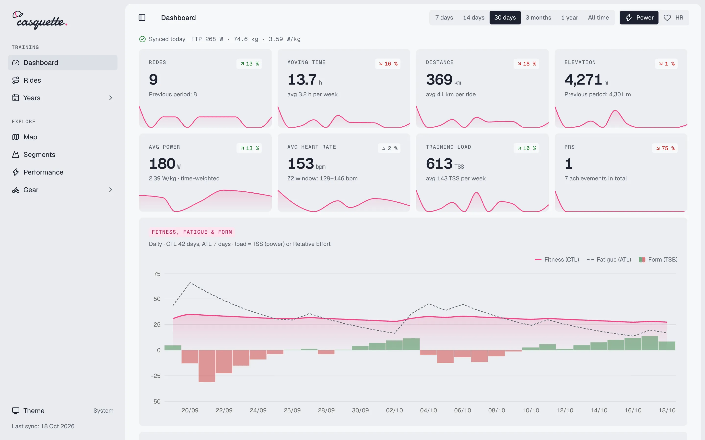
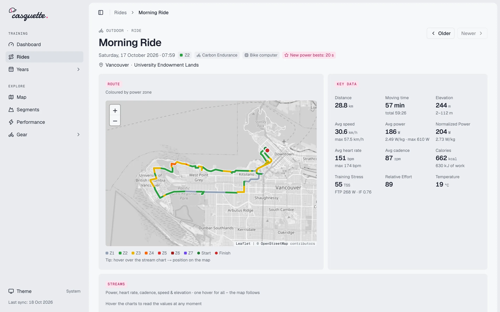
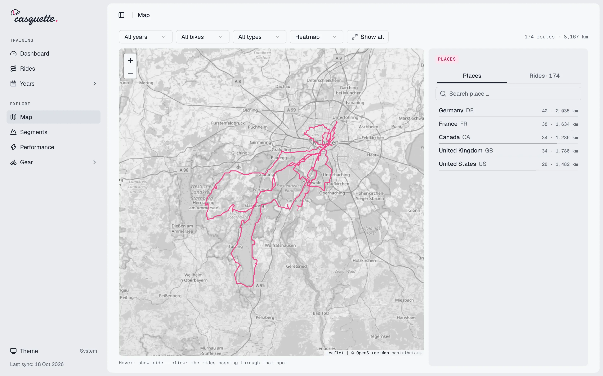
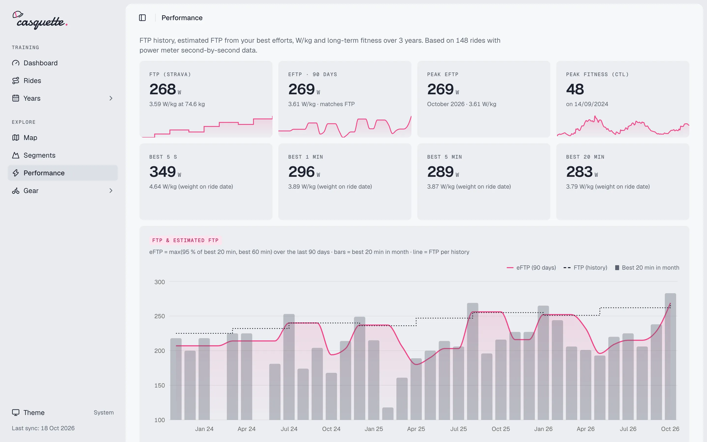
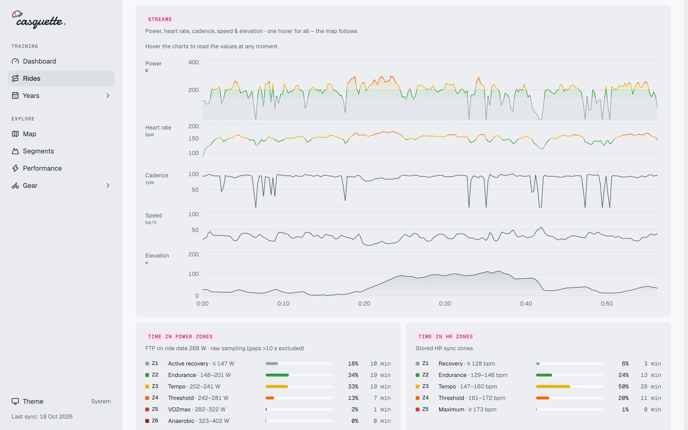
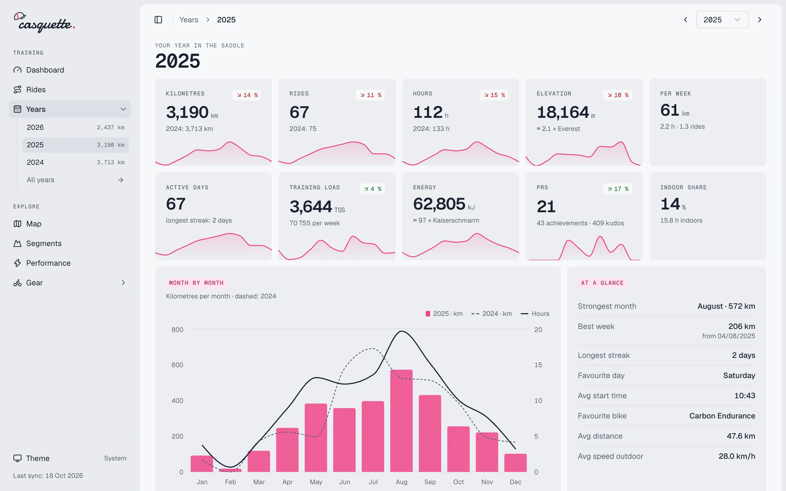
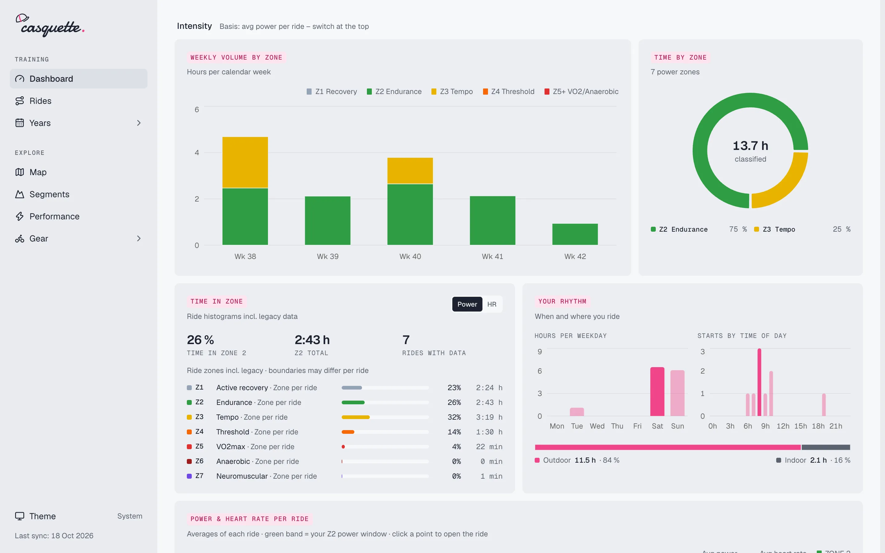

<h1 align="center">
  <picture>
    <source media="(prefers-color-scheme: dark)" srcset="brand/casquette-logo-dark.png">
    
  </picture>
</h1>

<p align="center">A personal training dashboard for your rides: a static site built from your Strava data that stays on your machine.</p>

<p align="center">
  <picture>
    <source media="(prefers-color-scheme: dark)" srcset="docs/screenshots/dashboard-dark.webp">
    
  </picture>
</p>

Casquette turns your rides into a fast, fully static website. Every ride becomes a Markdown file with all of its data in the frontmatter. Astro builds the pages from those files, so nothing runs on a server. A fresh clone ships with a synthetic demo dataset, so you can look around before you connect anything.

## Features

Every page shares the same frame: a collapsible sidebar with all pages, a slim header with breadcrumbs and, on Dashboard and Rides, the period (7 days, 14 days, 30 days, 3 months, 1 year, all time) and the zone basis (power or heart rate). Your choice is kept across pages. Calm grey-and-pink cards and charts (zones keep their traditional colours) with exact values on hover, sortable tables, light, dark or system theme.

| Page | What you get |
|---|---|
| Dashboard `/` | Key figure cards with the change against the previous period, fitness, fatigue and form chart, 52-week training calendar heatmap, form today, 80/20 check, power profile, training load, goals, zones and intensity, power and heart rate, efficiency, power curve, ride analysis, history, records, fuelling, recent rides |
| Rides `/rides` | The ride log for the chosen period as a table: sort any column, search by name or place, show or hide columns, click a row to open the ride |
| Ride `/rides/[id]` | Route map coloured by power zone, key data, power and heart-rate streams coloured by zone plus cadence, speed and elevation, with one shared hover that the map follows, time in power and heart rate zones, power curve vs. year and all-time, performance analysis and fuelling, laps, segments, kilometre splits, raw data |
| Years `/years` | All years compared, and a "wrapped"-style review per year: key figures vs. the previous year, months, at a glance, calendar, months in detail, intensity, time in zones, power curve, bikes, highlights, top 10, all rides |
| Map `/map` | Heatmap of all outdoor routes, filter by year, bike or type, colour by year or bike. Browse places by country, region and town, or click the map to see every ride that passed there |
| Segments `/segments` | All segments in a searchable table (all, ≥ 2 attempts, climbs, virtual). Per segment: attempts, PR history, watts vs. time, segment map and elevation profile |
| Performance `/performance` | FTP history, estimated FTP, best efforts, W/kg and weight, long-term fitness, power curve, power profile per year |
| Gear `/gear` | All bikes with distance per year, kilometres per bike and year. Per bike: key figures, setup, distance per month, power curve, records, cost per km, all rides |

<table>
  <tr>
    <td width="33%">
      <picture>
        <source media="(prefers-color-scheme: dark)" srcset="docs/screenshots/ride-dark.webp">
        
      </picture>
    </td>
    <td width="33%">
      <picture>
        <source media="(prefers-color-scheme: dark)" srcset="docs/screenshots/map-dark.webp">
        
      </picture>
    </td>
    <td width="33%">
      <picture>
        <source media="(prefers-color-scheme: dark)" srcset="docs/screenshots/performance-dark.webp">
        
      </picture>
    </td>
  </tr>
  <tr>
    <td width="33%">
      <picture>
        <source media="(prefers-color-scheme: dark)" srcset="docs/screenshots/ride-charts-dark.webp">
        
      </picture>
    </td>
    <td width="33%">
      <picture>
        <source media="(prefers-color-scheme: dark)" srcset="docs/screenshots/year-dark.webp">
        
      </picture>
    </td>
    <td width="33%">
      <picture>
        <source media="(prefers-color-scheme: dark)" srcset="docs/screenshots/zones-dark.webp">
        
      </picture>
    </td>
  </tr>
</table>

## Quick start

You need Node.js 22.12 or newer. To sync your own rides you also need a **Strava subscription**: since June 2026 Strava only lets subscribers create the personal API application the sync uses (one per Strava account). The demo runs without any account.

### 1. Try it with demo data

Clone this repository, then:

```bash
npm ci
npm run dev        # http://localhost:4321
```

Without any synced rides, Casquette shows about three years of generated rides, bikes, goals and FTP history. The data is synthetic: a made-up "travelling rider" who rides real roads in Munich, London, Paris, New York and Vancouver, with real place names and well-known segments such as Box Hill or Swain's Lane. Nothing comes from a real person's rides. A "Demo data" entry in the sidebar marks it and links to the setup steps. As soon as your first ride is synced, the whole site switches to your data and the entry disappears. Demo and real data are never mixed.

### 2. Connect Strava

1. **Create a Strava API application** at <https://www.strava.com/settings/api>. Pick any name and website (e.g. `http://localhost`), and set **Authorization Callback Domain** to `localhost`.
2. **Create `.env`** from the template and fill in the Client ID and Client Secret of your app:
   ```bash
   cp .env.example .env
   ```
3. **Authorize** once. This opens Strava in your browser and stores a token locally (`.strava-token.json`, refreshed automatically):
   ```bash
   npm run strava:auth
   ```
4. **Sync your history.** Strava's rate limits allow only a limited number of requests per 15 minutes and per day. `sync:all` waits them out and keeps going until your complete history is downloaded, newest rides first. You can stop it at any time; the next run continues where it left off.
   ```bash
   npm run sync:all
   ```
5. **Look up places** once (optional). This reverse-geocodes your routes via OpenStreetMap Nominatim at one request per second, so a large history can take an hour or more. It can be interrupted and resumed. Afterwards every sync handles new places itself.
   ```bash
   npm run geo
   ```
6. **Start the dashboard.** If `npm run dev` was already running during your first sync, restart it.
   ```bash
   npm run dev
   ```

From then on, run `npm run sync` whenever you want new rides. How the sync works in detail (rate limits, cache and offline rebuild, power and HR backfill, geocoding): [`docs/sync.md`](docs/sync.md).

## Your data stays local

Your rides contain heart rate, power and GPS tracks. The start and end of most rides give away your home address. That is why none of your data is ever committed: everything the sync writes is ignored by Git (see `.gitignore`).

| Ignored | Contents |
|---|---|
| `.env`, `.strava-token.json` | Your API credentials and access token |
| `.strava-cache/` | API cache (summaries, details, derived stream data) for offline rebuilds |
| `src/content/rides/` | One Markdown file per ride |
| `src/content/gear/` | One Markdown file per bike or pair of shoes |
| `public/streams/` | Second-by-second data (including GPS) for charts and maps |
| `src/data/athlete.json` | Profile, zones, FTP, gear |
| `src/data/fitness-history.json` | FTP and weight history |
| `src/data/goals.json` | Your goals |
| `src/data/zones.json` | Your own heart rate and power zones (optional) |
| `src/data/geo-cells.json` | Place cache, which reveals every place you have ridden through |

Only the empty folders and the example files `src/data/*.example.json` are tracked. Never force-add these files, and keep a backup of them yourself: they are not in the repository, so Git won't restore them.

## Configuration

**Goals:** copy the example and edit it. Without `src/data/goals.json`, Casquette uses the example.

```bash
cp src/data/goals.example.json src/data/goals.json
```

```json
{ "id": "year-km", "label": "Distance per year", "period": "year", "metric": "distance", "target": 5000 }
{ "id": "week-z2", "label": "Zone 2 per week", "period": "week", "metric": "zone_time", "zone": 2, "basis": "power", "target": 3 }
{ "id": "month-long", "label": "Long rides", "period": "month", "metric": "long_rides", "min_km": 80, "target": 2 }
```

`period`: `year`, `month`, `week`. `metric`: `distance` (km), `time` (h), `elevation` (m), `count`, `tss`, `zone_time` (h), `long_rides`.

**FTP and weight history:** Strava only provides your current values. The sync appends every change to `src/data/fitness-history.json` (created on the first sync). Add older FTP tests by hand; IF, TSS and W/kg of each ride are then calculated with the values valid on the ride date. `npm run build` applies changes, no new sync needed.

```json
{ "id": "2024-03-01", "date": "2024-03-01", "ftp": 230, "weight": 78, "source": "manual", "note": "Ramp test" }
```

**Zones:** by default, heart rate zones come from Strava and power zones are Coggan, from the FTP on the ride date. To use your own, copy the example and edit it. Unlike the goals, the example is never used on its own: without `src/data/zones.json` nothing changes. `npm run build` applies changes, no new sync needed; the Zones card on the dashboard shows where your zones come from.

```bash
cp src/data/zones.example.json src/data/zones.json
```

```json
{ "heart_rate": [{ "from": "2023-01-01", "bpm": [0, 125, 145, 160, 175] }, { "from": "2025-03-01", "bpm": [0, 130, 150, 165, 180] }],
  "power": { "ftp_percent": [0, 55, 75, 90, 105, 120, 150] } }
```

`heart_rate`: the lower bounds of Z1–Z5 in bpm, starting at 0. Each entry applies from its `from` date to the next one; leave `from` out for zones that never changed. `power`: the lower bounds of Z1–Z7 in % of FTP, starting at 0; leave it out to keep Coggan. Either part is optional.

Heart rate time in zones is computed from an HR distribution the sync stores per ride. Rides synced before this existed keep the zone times stored at sync until you run `npm run sync -- --backfill-hr` once ([details](docs/sync.md#power-and-hr-backfill)).

**Gear details:** in `src/content/gear/<id>.md`, the `custom:` block and the text below the frontmatter belong to you. The sync never touches them.

```yaml
custom:
  purchase_date: "2024-03-15"
  price_eur: 4200          # enables cost per km on the gear page
  components: ["Shimano GRX 2x12", "Zipp 303 S"]
  color: "Sand"
  notes: "Favourite bike for long gravel days"
```

**Environment variables** (in `.env`):

| Variable | Purpose |
|---|---|
| `STRAVA_CLIENT_ID`, `STRAVA_CLIENT_SECRET` | Your Strava API application (required for syncing) |
| `FTP`, `WEIGHT` | Fallbacks if Strava provides no values |
| `STRAVA_AUTH_PORT` | Local port for the OAuth callback (default `8723`) |
| `GEO_BUDGET_MIN` | Minutes per sync spent on looking up new places (default `15`) |
| `PUBLIC_LANG` | UI language (default `en`) |

Geocoding settings (`GEO_LANG`, `NOMINATIM_URL`, `NOMINATIM_UA`) are described in [`docs/sync.md`](docs/sync.md#places-and-countries).

**Language:** all UI text lives in `src/i18n/en.js`. To add a language, copy that file, translate it, register it in `src/i18n/index.js` and set `PUBLIC_LANG`.

## Scripts

| Command | What it does |
|---|---|
| `npm run dev` | Start the dev server at `http://localhost:4321` |
| `npm run build` | Build the static site into `dist/` |
| `npm run preview` | Serve the built site locally |
| `npm run strava:auth` | Connect to Strava once (OAuth) |
| `npm run sync` | Fetch new rides plus as much history as today's rate limit allows |
| `npm run sync:all` | Like `sync`, but waits out rate limits until the full history is there |
| `npm run sync:rebuild` | Rewrite all ride files from the local cache, offline |
| `npm run geo` | Look up places for all rides (one-off, resumable) |
| `npm test` / `npm run test:watch` | Run the tests once / in watch mode |
| `npm run test:e2e` | Build the demo site and run the browser tests ([details](#tests)) |
| `npm run test:website` | Browser test of the promo website in `website/` |
| `npm run demo:generate` | Regenerate the demo dataset in `demo/` (deterministic, offline) |
| `npm run demo:fetch-routes` | Refresh the cached road geometry of the demo routes (uses the BRouter web service; [details](#demo-data)) |
| `npm run screenshots` | Retake the README screenshots from the demo build ([details](docs/screenshots/README.md)) |
| `npm run demo:check -- <dir> [--base /demo/]` | Fail unless a demo build contains only demo data and works under its base path |

Sync flags such as `--limit`, `--no-geo` and `--backfill-power` are described in [`docs/sync.md`](docs/sync.md).

## Building and hosting

```bash
npm run build      # static site in dist/
```

`dist/` is plain HTML, CSS, JS and JSON. Host it wherever you like, or just run it locally. Syncing is always manual: sync, then build again.

> [!WARNING]
> The built site contains your health and location data, including GPS tracks. If you put it on the public internet, protect it (e.g. with HTTP basic auth). Don't publish it on open static hosting.

The promo website and the public demo (synthetic data only) are built separately: `npm run site:build` fills the website's legal pages from `SITE_LEGAL_*` variables and can add Cabin analytics. With `PUBLIC_LEGAL_URL` set at build time, the app links to those legal pages from its sidebar. See [`website/README.md`](website/README.md).

The live website and demo deploy themselves: on every push to `main`, [`.github/workflows/pages.yml`](.github/workflows/pages.yml) publishes the website at `/` and the demo (built from the demo dataset, checked by `npm run demo:check`) at `/demo/` on GitHub Pages.
It reads the custom domain (`PAGES_DOMAIN`) and the legal details (`SITE_LEGAL_*`, optional `SITE_CABIN_HOST`) from repository variables; your own copy of Casquette needs none of this ([details](website/README.md#in-the-deploy-54)).

## Tech stack

- [Astro 7](https://astro.build) with content collections: fully static
- [React](https://react.dev) islands with [shadcn/ui](https://ui.shadcn.com) and [Tailwind CSS v4](https://tailwindcss.com), charts with [Recharts](https://recharts.org) (shadcn charts), tables with [TanStack Table](https://tanstack.com/table)
- [Leaflet](https://leafletjs.com) with OpenStreetMap tiles for maps (no API key)
- OpenStreetMap [Nominatim](https://nominatim.org) for place names
- Sync scripts without dependencies, Node.js only
- [Vitest](https://vitest.dev) for unit tests, [Playwright](https://playwright.dev) with [axe](https://github.com/dequelabs/axe-core-npm) for browser tests

Design system: [`DESIGN.md`](DESIGN.md) · Domain terms: [`GLOSSARY.md`](GLOSSARY.md) · Architecture decisions: [`docs/adr/`](docs/adr/)

## Tests

```bash
npm test
```

Tests live next to the code (`*.test.js`) under `src/` and `scripts/`. The build reads all its data through one build dataset (`src/lib/build-dataset.js`, [`docs/ride.md`](docs/ride.md#build-dataset-and-page-payloads)); tests give it an in-memory data source and a fixed clock instead of files.

```bash
npm run test:e2e
```

Browser tests in `e2e/` run against a production build of the demo dataset (`DATA_SOURCE=demo`, built into `dist-e2e/`), so they never touch your own rides. They use a locally installed Chromium or Chrome (`CHROME_PATH` to pick one); without one, run `npx playwright install chromium` once.

Specs import `test` and `expect` from `e2e/fixtures.ts`: `page.goto` there waits until every island has hydrated (`<html data-hydrated>`, set by `useIslandReady()` in each `client:load` component), and motion is reduced. After navigating by a click, call `hydrated(page)` before interacting. Keep one page per test for heavy checks such as axe; `e2e/demo.ts` lists the demo years and bikes for that.

```bash
npm run test:website
```

The promo website (`website/`, plain HTML without a build) has its own browser test in `e2e-website/` (`playwright.website.config.ts`): it serves the folder as is and checks it loads without errors and passes axe in light and dark. It needs no build and doesn't run with `test:e2e`.

## Demo data

The demo dataset in `demo/` is generated by `npm run demo:generate` (seeded, byte-for-byte reproducible, no network). Its routes are hand-picked waypoints per city (`scripts/lib/demo-cities.mjs`). `npm run demo:fetch-routes` asks the public [BRouter](https://brouter.de) cycling router once for a road-following track through them and stores the simplified result, with elevation, in `demo/source/routes/`. Run it only after changing the waypoints, then regenerate the demo data.

Route geometry in `demo/source/routes/` and the demo rides derived from it: © [OpenStreetMap](https://www.openstreetmap.org/copyright) contributors, available under the [Open Database License (ODbL)](https://opendatacommons.org/licenses/odbl/). Routed with BRouter; elevation from SRTM via BRouter.

## Strava

Casquette uses the Strava API to read your own activities. This project is independent and is not developed, sponsored or endorsed by Strava. Map data and demo route geometry © [OpenStreetMap](https://www.openstreetmap.org/copyright) contributors (ODbL).

## License

[MIT](LICENSE)
